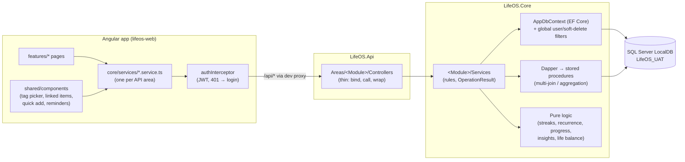

# LifeOS architecture

How the pieces fit together, for someone about to change the code. The rules themselves (naming, the checklist for a
schema change, the gotchas) are in [`CLAUDE.md`](../CLAUDE.md); the *why* behind the big decisions is in
[`LifeOS_Development_Plan.md`](../LifeOS_Development_Plan.md) Sections 2–3.

## The shape of it

A request: the page calls its service → `HttpClient` → the interceptor adds the token → the controller binds and
validates the request → the module's service applies the rules and returns `OperationResult<T>` → the controller
wraps it in `ApiResponse<T>` (200 with `data`, or 400/404 with `message`). Unexpected exceptions go to
`GlobalExceptionHandler`, validation failures to `ValidationResponse`: same envelope either way, so the client reads
every error with `apiErrorMessage(err, fallback)`.

## Modules

| Module | SQL schema | Tables | Server (`LifeOS.Core/…`) | Pages (`features/…`) |
|---|---|---|---|---|
| Shared platform | `shared` | Users, LifeAreas (seeded, global), Tags, EntityLinks, InboxItems | `Shared/` — Auth, JWT, current user, Tags, EntityLinks, Inbox, LifeAreas | `auth`, `inbox`, `tags` |
| Goals & Milestones | `goals` | Goals, GoalMilestones, GoalTags, GoalHistory | `Goals/` | `goals` |
| Tasks & Projects | `tasks` | TaskItems, Projects, TaskTags | `Tasks/` | `tasks`, `projects` |
| Calendar & Reminders | `calendar` | Events, Reminders | `Calendar/` (+ proc `calendar.GetCalendarFeed`) | `calendar`, `reminders` |
| Habits | `habits` | Habits, HabitEntries | `Habits/` | `habits` |
| Journal | `journal` | JournalEntries, WeeklyReflections | `Journal/` | `journal` |
| Story Mode (Phase 2, in progress) | `story` | Chapters, MissionPrerequisites, MissionDebriefs, LifeAreaRatings | `Story/` — Chapters, Life Story (+ proc `story.GetLifeStory`, recap), Missions, life-area levels + monthly ratings (+ proc `story.GetLifeAreaStats`); pure `MissionKinds`/`MissionGraph`/`ChapterRules`/`LifeStoryBuilder`/`LifeAreaLevels`/`StoryRecap` | `story` (`/story`, `/missions`, `/life-areas`, Mission passed dialog, goal-page Story card, "Previously on…" card on My Day; Session 32 adds achievements) |
| Dashboard & Insights | `dashboard` (procedures only) | — | `Dashboard/` (+ procs `dashboard.GetMyDay`, `dashboard.GetLifeBalance`) | `dashboard` (My Day) |

Every module has the same server layout: `DTOs/` (request/response shapes, status constants), `ServiceContracts/`
(interfaces), `Services/` (implementations and pure helpers), `AutoMapper/` (entity → DTO profiles). Controllers live
in `LifeOS.Api/Areas/<Module>/Controllers/` and are routed `api/<Module>/<Controller>`.

## Data rules that apply everywhere

- **Database-first.** `database/schema/NN_<module>.sql` is the source of truth; `LifeOS.Core/Models/` is generated
  from the database by `dotnet ef dbcontext scaffold` and never edited. Hand additions to entities are partial classes
  in `Shared/ModelExtensions/`.
- **Every user-owned row has a `UserId`, and soft delete is the only delete.** One reflective global query filter
  (`AppDbContext.SoftDelete.cs`) applies `!IsDeleted && UserId == CurrentUserId` to every entity that implements
  `ISoftDeletable` and `IUserOwned`, so EF queries can't see another user's data or deleted rows. Stored procedures
  sit outside EF, so each one filters `UserId` and `IsDeleted` itself, joined parents included.
- **Two kinds of time.** Calendar days (due dates, habit days, journal days, all-day events) are `DATE` and mean the
  user's local day. Moments (`CreatedAt`, `CompletedAt`, timed events, reminders) are `DATETIME2` in UTC and come back
  with a `Z`. The server doesn't know the user's timezone, so anything that depends on "today" takes it from the
  client (`today=2026-10-15`), and range queries take the local days *plus* the same span as UTC instants
  (`fromUtc`/`toUtc`, local midnight to local midnight).
- **Business failures are values, not exceptions.** Services return `OperationResult<T>` (`Ok`/`Fail(message)`);
  exceptions are for the unexpected. Unique constraints are checked up front *and* backed by catching SQL errors
  2627/2601, since two requests can race.
- **Computed, never stored:** goal progress (`GoalProgress`), habit streaks (`HabitStreaks`), the next occurrence of
  a repeating task (`TaskRecurrence`), insights (`DashboardInsights`), life balance (`LifeBalance`). Each is a pure
  static class with xUnit tests, so it can't drift from the data it summarises.

## Cross-cutting features

- **EntityLinks**: undirected "related to" links between any two items. Each linkable type registers an
  `ILinkableEntityProvider` (a stable type string, titles and search through `AppDbContext`, so the filters apply).
  Links are stored in one canonical direction, so a unique index rejects duplicates either way. Deleting an item
  removes its links. UI: `<app-linked-items entityType="Goal" [entityId]="id" />`.
- **Inbox / Quick Add**: press <kbd>Q</kbd> anywhere to capture a task, note, journal line or idea into
  `shared.InboxItems`. Modules turn items into real entities ("Make it a task", "Add to journal"), moving the item's
  links and marking it processed in one transaction.
- **Reminders**: point in time + optional target (any linkable type). There's no background job: what's due is
  worked out per request. The shell polls every minute and on tab focus, which feeds the sidebar badge, the My Day
  card and the toasts. Deleting an item removes its reminders.
- **Tags**: one shared `shared.Tags` list per user, attached through a per-module join table (`goals.GoalTags`,
  `tasks.TaskTags`). No per-module category enums.
- **History**: goals log status changes and revisions to `goals.GoalHistory`. New audit trails follow the same
  small per-module table pattern.

## Stored procedures (Dapper)

EF Core handles single-entity CRUD. Queries that join across schemas or aggregate are hand-written procedures in
`database/procedures/`, called through Dapper on the context's own connection:

| Procedure | Used by | Returns |
|---|---|---|
| `calendar.GetCalendarFeed` | `GET api/Calendar/Feed` | events + task due dates + milestone and goal targets in a range, one row shape |
| `dashboard.GetMyDay` | `GET api/Dashboard/MyDay` | seven result sets (`QueryMultiple`): tasks, events, reminders, goals, habits, habit entries, latest journal |
| `dashboard.GetLifeBalance` | `GET api/Dashboard/LifeBalance` | per life area: active goals, completions, habit days, journal entries |
| `story.GetLifeAreaStats` | `GET api/Story/LifeAreas/stats` | all-time counts per life area (goals passed, objectives, habit days, journal entries) → `LifeAreaLevels` XP and level in C# |
| `story.GetLifeStory` | `GET api/Story/LifeStory` | every story beat (goal events, objectives, habits begun, great/hard days); the service maps moments to local days with the user's IANA timezone |

Rows come back as DATE → `DateTime` and DATETIME2 → unspecified kind; the service converts them to `DateOnly` and UTC
(EF's UTC converter doesn't cover Dapper).

## API surface

All routes need a JWT except register, login and ping.

| Area | Endpoints |
|---|---|
| `api/Shared/Auth` | `POST register`, `POST login`, `GET me` |
| `api/Shared/Tags`, `Inbox`, `LifeAreas`, `EntityLinks` | CRUD; Inbox `PUT {id}/processed`; EntityLinks `GET types`, `GET candidates` |
| `api/Goals/Goals` | CRUD, `PUT {id}/status`; milestones under `Goals/{goalId}/Milestones` (CRUD, `PUT {id}/completed`, `PUT order`) |
| `api/Tasks/Tasks` | CRUD, `PUT {id}/completed`, `POST from-inbox/{id}` |
| `api/Tasks/Projects` | CRUD, `PUT {id}/status` |
| `api/Calendar/Events`, `Feed`, `Reminders` | Events CRUD; `GET Feed?from&to&fromUtc&toUtc`; Reminders CRUD, `GET due`, `PUT {id}/dismissed`, `PUT {id}/snooze` |
| `api/Habits/Habits` | CRUD, `PUT {id}/status`, `PUT {id}/entries/{date}` (tick/untick, returns the new streak) |
| `api/Journal/Entries`, `Reflections` | entries by day (`GET`/`PUT`/`DELETE day/{date}`), `GET moods`, `POST from-inbox/{id}`; reflections `GET`/`PUT {monday}` |
| `api/Dashboard/MyDay`, `LifeBalance` | the My Day snapshot (with insights); activity per life area |
| `api/Story/Chapters`, `LifeStory` | Chapters CRUD (a new current chapter closes the previous); the story filed into chapters (`?tz=`); `GET LifeStory/recap?tz=` (current chapter, last 3 beats up to today, current mission) |
| `api/Story/LifeAreas` | `GET stats` (XP + level per area), `GET ratings?from&to` (months by first day), `PUT ratings/{month}` (`{ today, ratings: [{ lifeAreaId, rating 1–10 | null, note }] }`, null clears; rewritten in place) |
| `api/Story/Missions` | goals as missions (`GET`, `GET {goalId}`), `POST {goalId}/prerequisites`, `DELETE {goalId}/prerequisites/{requiresGoalId}`, `GET {goalId}/passed`, `PUT {goalId}/debrief` |

Swagger UI (`/swagger`, Development only) has the full request/response shapes.

## Frontend

- **Shell** (`core/layout/shell.*`): sidebar plus mobile drawer, rendered from `NAV_GROUPS` in `nav-items.ts`. It
  mounts Quick Add and the toasts and polls due reminders. Every route is lazy-loaded and has a `title`.
- **Data access**: one service per API area in `core/services/`, returning plain observables of the unwrapped
  `data`. Components never touch `HttpClient`. Shared lookups (life areas) are cached with `shareReplay` and never
  error.
- **State**: signals in components, OnPush everywhere, reactive forms. Every form field shows its own inline error;
  every input has a placeholder.
- **Dates**: one display format (`14/Oct/2026`) set via `DATE_PIPE_DEFAULT_OPTIONS`; ng-bootstrap datepickers (never
  `<input type="date">`); local-date helpers in `core/dates/today.ts`, tested in six timezones (`npm run test:tz`).
- **Failure handling**: `apiErrorMessage` for toasts; `<app-load-error>` instead of an empty state when a page's
  load fails; a 401 sends the user to login and back.
- **Styling**: CoreUI CSS as the single framework, LifeOS colour tokens in `styles.scss` (`--lifeos-*`), Sora +
  Manrope. Bespoke CSS only where a module needs its own visuals (My Day, Calendar, habit cells, life balance bars).

## Adding a module (checklist)

1. `database/schema/NN_<module>.sql`: its own SQL schema, base columns, `UserId`, named PKs and `CHECK`
   constraints, filtered unique indexes. Apply it to UAT twice (it must be re-runnable), re-scaffold, review the
   `Models/` diff.
2. Partial classes `: ISoftDeletable, IUserOwned` in `Shared/ModelExtensions/EntityPartials.cs`.
3. `LifeOS.Core/<Module>/{DTOs,ServiceContracts,Services,AutoMapper}`; register the service in `Program.cs`. If its
   items should be linkable or remindable, add an `ILinkableEntityProvider`; its delete removes links and reminders.
4. Thin controllers in `LifeOS.Api/Areas/<Module>/Controllers/`.
5. `core/services/<module>.service.ts`, `features/<module>/`, a route replacing the `placeholder(...)` one, and a
   nav entry.
6. Pure rules get xUnit or vitest tests; date logic gets `npm run test:tz`.
7. Build clean, lint and Prettier clean, check it in the browser (including phone width), commit, update
   `PROGRESS.md`.
