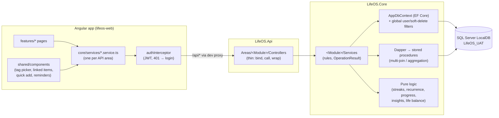

# LifeOS architecture

How the pieces fit together, for someone about to change the code. The rules themselves (naming, the checklist for a
schema change, the gotchas) are in [`CLAUDE.md`](../CLAUDE.md); the *why* behind the big decisions is in
[`LifeOS_Development_Plan.md`](../LifeOS_Development_Plan.md) Sections 2–3.

## The shape of it

A request: the page calls its service → `HttpClient` → the interceptor adds the token → the controller binds and
validates the request → the module's service applies the rules and returns `OperationResult<T>` → the controller
wraps it in `ApiResponse<T>` (200 with `data`, or 400/404 with `message`). Unexpected exceptions go to
`GlobalExceptionHandler`, validation failures to `ValidationResponse`: same envelope either way, so the client reads
every error with `apiErrorMessage(err, fallback)`.

## Modules

| Module | SQL schema | Tables | Server (`LifeOS.Core/…`) | Pages (`features/…`) |
|---|---|---|---|---|
| Shared platform | `shared` | Users, LifeAreas (seeded, global), Tags, EntityLinks, InboxItems, UserHiddenModules, UserHiddenLifeAreas, RecoveryCodes, Contacts (+ ContactTags — the one people list, Session 51) | `Shared/` — Auth, JWT, current user, Tags, EntityLinks, Inbox, LifeAreas, Search, Settings, `ContactsService` + `ContactLinkableProvider` | `auth`, `inbox`, `tags`, `search`, `settings` |
| Goals & Milestones | `goals` | Goals, GoalMilestones, GoalTags, GoalHistory | `Goals/` | `goals` |
| Tasks & Projects | `tasks` | TaskItems, Projects, TaskTags | `Tasks/` | `tasks`, `projects` |
| Calendar & Reminders | `calendar` | Events (one-off or recurring series), EventExceptions (skipped occurrences), Reminders (one-time or repeating; occurrence reminders of events) | `Calendar/` (+ proc `calendar.GetCalendarFeed`) | `calendar`, `reminders` |
| Habits | `habits` | Habits, HabitEntries | `Habits/` | `habits` |
| Journal | `journal` | JournalEntries, WeeklyReflections | `Journal/` | `journal` |
| Story Mode (Phase 2) | `story` | Chapters, MissionPrerequisites, MissionDebriefs, LifeAreaRatings | `Story/` — Chapters, Life Story (+ proc `story.GetLifeStory`, recap), Missions, life-area levels + monthly ratings (+ proc `story.GetLifeAreaStats`), achievements (+ proc `story.GetAchievementFacts`); pure `MissionKinds`/`MissionGraph`/`ChapterRules`/`LifeStoryBuilder`/`LifeAreaLevels`/`StoryRecap`/`Achievements` | `story` (`/story`, `/missions`, `/life-areas`, Mission passed dialog, goal-page Story card, `/achievements`, "Previously on…" card on My Day) |
| Documents (Phase 2) | `documents` | Documents (kind, issuer, last 4 of the number, issued/expiry, vault flag), DocumentFiles (stored name, original name, type, size, SHA-256), DocumentTags | `Shared/` — `IFileStore`/`DiskFileStore` + pure `FileRules` (Session 38); `Documents/` — `DocumentsService`, `DocumentLinkableProvider`, pure `DocumentRules` (last 4, expiry reminder time) | `documents` (`/documents` library, `/documents/:id` with upload + preview, "Documents expiring" card on My Day) |
| Education & Learning (Phase 2) | `learning` | Skills (+ SkillLevelChanges, SkillTags), Courses, Books (+ BookTags, BookNotes), Certifications, StudySessions, Roadmaps (+ RoadmapSteps), KnowledgeNotes (+ KnowledgeNoteTags) | `Learning/` — `SkillsService` (level history), `CoursesService`, `BooksService` (progress, notes), pure `LearningRules`; `RoadmapsService` + pure `RoadmapProgress`, `StudySessionsService`, `CertificationsService` (renewal reminder), `KnowledgeNotesService` (knowledge base: tags, `KnowledgeNoteLinkableProvider`, `?skillId=`) + pure `RevisionPlanner`; study analytics (+ proc `learning.GetStudyBySubject` → pure `StudyAnalytics`) | `learning` (`/learning/skills[/:id]`, `/learning/courses`, `/learning/books[/:id]`, `/learning/roadmaps[/:id]`, `/learning/study`, `/learning/notes`, `/learning/certifications`) |
| Career & Professional Growth (Phase 2) | `career` | Employments, SalaryRecords, CareerAchievements, PerformanceReviews, ResumeVersions, JobApplications (+ ApplicationStageChanges), Interviews (rounds, each optionally a calendar Event), InterviewQuestions (+ InterviewQuestionTags), SideIncomeSources — people are `shared.Contacts` | `Career/` — `EmploymentsService` (+ promotion), `SalaryRecordsService`, `CareerAchievementsService`, `JobApplicationsService` (stage moves), `InterviewsService` (keeps each round's calendar Event in step), `InterviewQuestionsService`, `ResumeVersionsService` (files are attachments), `PerformanceReviewsService`, `SideIncomeSourcesService`, pure `CareerRules`/`SalaryHistory`/`ApplicationRules`, `Employment`/`CareerAchievement`/`JobApplication`/`InterviewQuestion`/`ResumeVersion` providers; Life Story career beats in `story.GetLifeStory` | `career` (`/career` timeline, `/career/salary`, `/career/achievements`, `/career/applications` board + `/career/applications/:id`, `/career/questions`, `/career/resumes`, `/career/reviews`, `/career/side-income`, `/career/network`); `contacts` (contact editor) |
| Personal Finance (Phase 2) | `finance` | PlanAssumptions (one per user: return, inflation, retirement age and years, spending — projections computed), Scenarios + ScenarioLines (what-ifs in the base currency — their impact computed, never written to the ledger), Accounts (opening balance + date — balances are computed, never stored), Transactions (one row per movement: Income has only `ToAccountId`, Expense only `FromAccountId`, Transfer both and different; + TransactionTags; optional employment / side income / loan / schedule occurrence), RecurringTransactions (+ RecurringTransactionTags, `GeneratedThrough`), Budgets (per tag per month), Holdings (+ HoldingValuations), Loans, InsurancePolicies, TaxItems | `Finance/` — `AccountsService` (balances via proc `finance.GetAccountBalances`), `TransactionsService` (ledger + totals), `RecurringTransactionsService` (schedules; `GenerateDueAsync` writes what's due, called by the client before Finance reads), `BudgetsService` (proc `finance.GetMonthSummary`; also feeds My Day's `OverBudget` insight), `HoldingsService` (valuations), `PlanService` (savings goals' monthly plans + retirement projection from `PlanAssumptions`, never stored), `ForecastService` (cash-flow forecast from every module's known money, never stored; takes extra flows for scenarios), `ScenariosService` (what-ifs: before → after on the forecast, savings goals and retirement, in memory), `LoansService` (EMI or pay as you go; the start and every repayment as transactions through `ITransactionsService`; outstanding from actual payments), `WealthService` (net worth + savings goals; proc `finance.GetNetWorthFacts`), `ExchangeRatesService` (rate master, read through `FinanceRates`), multi-currency accounts (`AccountCurrencies`, balances per currency through `MultiCurrency`), `InsurancePoliciesService` (owns the renewal reminder), `TaxItemsService` (due days on the calendar feed), `StatementImportService` (CSV lines in, `ImportHash` dedupe, all or nothing), `FinanceReportsService` (proc `finance.GetCashFlow`), pure `ProtectionRules`/`StatementImport`/`CashFlowReport`, pure `FinanceRules`/`WealthRules`/`RateRules`/`RecurringSchedule`/`BudgetSummary`/`LoanSchedule`/`LoanLedger`/`NetWorth`/`CashForecast`/`FinancialPlan`/`ScenarioMath`/`SavingsProgress`, `Holding`/`Loan`/`InsurancePolicy`/`TaxItem` providers, `FinanceAccount`/`Transaction` providers (transactions take receipts as attachments) | `finance` (`/finance` accounts, `/finance/transactions` ledger on ag-Grid, `/finance/recurring`, `/finance/budgets`, account/transaction/schedule editors, base-currency prompt, `/finance/insurance`, `/finance/taxes`, `/finance/reports`, `/finance/import` with the client-side CSV reader `statement-csv.ts`, `/finance/scenarios` "Can I afford it?" — opened pre-filled from wishlist items and shopping lists); Quick Add's "Log an expense" |
| Health & Wellness (Phase 3) | `health` | HealthProfiles (one per user), MedicalConditions (conditions, surgeries, allergies), DoctorVisits (doctor = a contact; appointment = a calendar Event; follow-up reminder), Medications + MedicationSchedules (local time × weekday bitmask) + MedicationDoses (one per schedule per day, or an as-needed dose), Workouts, Meals, WaterIntakes, SleepRecords (UTC span, counted on `WokeOn`), BodyMeasurements (one fixed unit per kind), LabResults (number or word, reference range), WellnessCheckIns (stress + energy per day), GoalTargets (a goal's body measure + start + target) — every `Notes` column encrypted | `Health/` — `HealthProfileService`, `WorkoutsService`, `SleepService`, `MeasurementsService`, `NutritionService` (pure `HealthLogRules`/`HealthTrends`), `LabResultsService`, `WellnessService`, `GoalTargetsService` (pure `HealthRecordRules`), `MedicalConditionsService`, `DoctorVisitsService` (owns the appointment event + follow-up reminder), `MedicationsService` (schedules, doses, adherence), pure `HealthRules`/`MedicationRules`, lock-aware `DoctorVisit`/`Medication`/`MedicalCondition` providers | `health` (`/health` overview, `/health/history`, `/health/visits`, `/health/medications`, `/health/fitness`, `/health/sleep`, `/health/body`, `/health/nutrition`, `/health/labs`, `/health/wellness`, editors, `<app-health-trend>`, the goal page's `<app-goal-target-card>`, `<app-todays-doses>`, My Day `<app-doses-card>`) |
| Home & Assets (Phase 3) | `home` | Properties (owned/rented, moved in/out), Assets (inventory by property + room, categories = AssetTags, disposal: sold/donated/discarded/lost), Vehicles (insurance = a Finance policy; PUC + registration valid-until with reminders), Warranties (warranty / extended / AMC on exactly one asset, vehicle or property; expiry reminder), MaintenanceTasks (every n days/weeks/months/years — next due computed from the last MaintenanceLogs.DoneOn) + MaintenanceLogs, UtilityBills (due day; paid → one Finance expense), HouseholdProjects (a tasks project + property + budget), FuelLogs (rate or quantity, missed-fill flag, optional one-time Finance expense; Vehicles.FuelUnit) | `Home/` — `PropertiesService`, `AssetsService` (tags, disposal, attachments), `VehiclesService` (PUC/registration reminders, odometer, next service), `WarrantiesService` (expiry reminder), `MaintenanceService` (logs, next due), `UtilityBillsService` (paid → one Finance expense through `ITransactionsService`), `HouseholdProjectsService` (a tasks project + budget; spend = linked expenses), `FuelLogsService` (fills, odometer only rises, one-time expense) + pure `FuelEconomy` (overall average from partial fills, trend, monthly spend), `HomeAgendaService` ("coming up" incl. unpaid bills, also on My Day), `HomeReminders` (the one owned-reminder helper), pure `HomeRules`, five linkable providers | `home` (`/home`, `/home/inventory`, `/home/vehicles`, `/home/warranties`, `/home/maintenance`, `/home/bills`, `/home/projects`, `/home/vehicles/:id/fuel`, editors + Done / Pay / Let go / fill dialogs, `<app-home-agenda-list>`; My Day "Coming up at home"; calendar "Bills" source) |
| Purchases & rewards (Phase 3) | `shopping` | ShoppingLists + ShoppingListItems, WishlistItems, Purchases (+ PurchaseTags; one Finance expense via unique TransactionId, the Home asset it became), Subscriptions (with an account: owns a Finance RecurringTransaction that writes each charge), Returns (deadline reminder, refund = one Finance income), Benefits (vouchers / gift cards / store credit / coupons / cashback / points / wallet credit; code + PIN in encrypted `…Secret` columns), BenefitRedemptions, PointBatches — balances, next charges and expiries computed | `Purchases/` — `PurchasesService` (one purchase = expense + inventory item + warranty + list items + wish + rewards used, in one transaction), `ShoppingListsService`, `WishlistService`, `BenefitsService` (balances / points / expiry computed by pure `BenefitRules`; bought = a purchase, cashback and cashed-in points = one income), `SubscriptionsService` (owns a Finance repeating transaction when charged to an account; renewals computed by pure `SubscriptionRules`, also in the calendar feed), `ReturnsService` (refund = one income), pure `PurchaseRules`, six linkable providers | `purchases` (`/purchases`, `/purchases/lists[/:id]`, `/purchases/wishlist`, `/purchases/rewards`, `/purchases/subscriptions`, `/purchases/returns`, purchase / reward / subscription / return editors, reward dialog, My Day "Don't miss" `<app-rewards-card>`, calendar "Renewals") |
| Family & relationships (Phase 3) | `people` | Relationships (tree edges between shared contacts; you = a null person; Parent directed, Partner/Sibling stored once smaller id first), SignificantDates (birthday / anniversary / other; month + day + optional year, 29 Feb allowed), Interactions + InteractionPeople (one call/visit with several people), KeepInTouch (cadence per contact), GiftIdeas (idea → bought → given; a bought gift points at its Purchase, never its own money), Responsibilities (held by me / shared / someone; optional task) — nothing scores a person, anything next/due is computed | `Family/` — `RelationshipsService` (tree edges + people directory), pure `FamilyTree` (generations, relation words), `SignificantDatesService` (yearly days; calendar + My Day from C#) + pure `SignificantDays`, `InteractionsService` (keeps `LastContactedOn`), `KeepInTouchService` (+ `KeepInTouch` insight), `GiftIdeasService`, `ResponsibilitiesService`, `IFamilyLogCleanup` (contact delete) | `family` (`/family`, `/family/people[/:id]`, `/family/tree`, `/family/keep-in-touch`, `/family/interactions`, `/family/responsibilities`; person page sections; My Day "Birthdays & anniversaries"; calendar "Birthdays") |
| Dashboard & Insights | `dashboard` | KpiTiles, DismissedInsights (the user's choices only — figures are computed) | `Dashboard/` (+ procs `dashboard.GetMyDay`, `dashboard.GetLifeBalance`, `dashboard.GetKpiFacts`); pure `DashboardInsights` (each insight keyed by its situation), `LifeBalance`, `KpiFigures` | `dashboard` (My Day: insights with dismiss, "Your figures" KPI tiles) |

Every module has the same server layout: `DTOs/` (request/response shapes, status constants), `ServiceContracts/`
(interfaces), `Services/` (implementations and pure helpers), `AutoMapper/` (entity → DTO profiles). Controllers live
in `LifeOS.Api/Areas/<Module>/Controllers/` and are routed `api/<Module>/<Controller>`.

## Data rules that apply everywhere

- **Database-first.** `database/schema/NN_<module>.sql` is the source of truth; `LifeOS.Core/Models/` is generated
  from the database by `dotnet ef dbcontext scaffold` and never edited. Hand additions to entities are partial classes
  in `Shared/ModelExtensions/`.
- **Every user-owned row has a `UserId`, and soft delete is the only delete.** One reflective global query filter
  (`AppDbContext.SoftDelete.cs`) applies `!IsDeleted && UserId == CurrentUserId` to every entity that implements
  `ISoftDeletable` and `IUserOwned`, so EF queries can't see another user's data or deleted rows. Stored procedures
  sit outside EF, so each one filters `UserId` and `IsDeleted` itself, joined parents included.
- **Two kinds of time.** Calendar days (due dates, habit days, journal days, all-day events) are `DATE` and mean the
  user's local day. Moments (`CreatedAt`, `CompletedAt`, timed events, reminders) are `DATETIME2` in UTC and come back
  with a `Z`. The server doesn't know the user's timezone, so anything that depends on "today" takes it from the
  client (`today=2026-10-15`), and range queries take the local days *plus* the same span as UTC instants
  (`fromUtc`/`toUtc`, local midnight to local midnight).
- **Business failures are values, not exceptions.** Services return `OperationResult<T>` (`Ok`/`Fail(message)`);
  exceptions are for the unexpected. Unique constraints are checked up front *and* backed by catching SQL errors
  2627/2601, since two requests can race.
- **Recurring events** (Session 33): a series is one `calendar.Events` row whose own dates are its first occurrence,
  plus `RecurrenceFrequency`/`RecurrenceInterval`/`RecurrenceUntil` and, for timed series, the IANA `TimeZone` whose
  wall clock it follows (09:00 stays 09:00 across DST). Occurrences are named by the day they start (in that zone) —
  that's the key of a skipped day in `calendar.EventExceptions`, and "change just this one" is a skip plus a new
  one-off event. Reminders and links attach to the series.
- **Repeating reminders** (Session 34): a reminder can carry the same rule (plus its zone and anchor); its `RemindAt`
  is always the next time, and "done" moves it on (`ReminderRecurrence.NextAfter`) until the rule runs out. A timed
  repeating event can "remind me N minutes before each": nothing is generated ahead — when an occurrence's reminder
  moment comes, reading due reminders writes it as an ordinary reminder about the event (`OccurrenceDate` set,
  unique per occurrence), so done/snooze/history need no special cases.
- **Computed, never stored:** goal progress (`GoalProgress`), habit streaks (`HabitStreaks`), the next occurrence of
  a repeating task (`TaskRecurrence`), the occurrences of a recurring event (`EventRecurrence`), insights (`DashboardInsights`), life balance (`LifeBalance`), goal progress over time (`GoalProgressTrend`), KPI figures (`KpiFigures`). Each is a pure
  static class with xUnit tests, so it can't drift from the data it summarises.

## Cross-cutting features

- **EntityLinks**: undirected "related to" links between any two items. Each linkable type registers an
  `ILinkableEntityProvider` (a stable type string, titles and search through `AppDbContext`, so the filters apply).
  Links are stored in one canonical direction, so a unique index rejects duplicates either way. Deleting an item
  removes its links. UI: `<app-linked-items entityType="Goal" [entityId]="id" />`.
- **Global search** (Session 36): `GET api/Shared/Search?q=` (`SearchService`) runs the same
  `ILinkableEntityProvider.SearchAsync` the link picker uses, one provider after another (one DbContext), 5 per type
  + `hasMore`, groups in a fixed order; journal hits get a `SearchSnippets.Around` excerpt of the text. A new linkable
  module is searchable with no change here. UI: the lazy-loaded palette (`features/search/search-palette`) opened by
  Ctrl/Cmd+K, `/` (outside fields), the sidebar Search button or the phone top bar, via `SearchPaletteService.open()`;
  results open through `EntityOpener` (shared with reminder targets).
- **Files** (Session 38): `IFileStore` (`DiskFileStore`, singleton) writes uploads to `<FileStorage:RootPath>/<userId>/`
  under a random stored name (32 hex + extension), streaming to a `.part` file while counting size and SHA-256, then
  checking the type twice — the extension must be on `FileRules`' list (no SVG/HTML/executables) and the first bytes
  must match it — before renaming into place. Callers keep the returned `StoredFile` in SQL and only ever pass a
  stored name back; anything else (slashes, `..`, a drive) is refused. Files are served only through the API, with
  the headers in one place (`FileResponses.Send` in `LifeOS.Api/Infrastructure`).
- **Vault** (Session 41): a sensitive document's files are written encrypted (`SaveAsync(..., encrypt: true)`: the
  upload is checked in memory and only ciphertext reaches disk) with Data Protection under a per-user purpose; the
  key ring lives in `FileStorage:KeysPath` (DPAPI-wrapped on Windows). Moving a document into or out of the vault
  rewrites each file under a **new** stored name (`IFileStore.RewriteAsync`), points the row at it with its
  `IsEncrypted` flag, saves, then deletes the old bytes — so a row and its bytes always agree. `IVaultService`:
  `POST api/Shared/Vault/unlock` checks the password and returns a 15-minute time-limited Data Protection token the
  client keeps in memory only and sends as `X-Vault-Unlock`; `IsUnlocked` checks it per request (423 Locked
  otherwise). Unlocks, failed unlocks, opens and "taken out of the vault" go to `shared.VaultAccessLog` (Settings ›
  Vault activity). Client: `VaultService` + `ensureVaultUnlocked(modal, vault, reason)`.
- **Sensitive columns** (Session 62): every string column named `…Notes` in a schema listed in
  `SensitiveColumns.Schemas` (`health` so far) is encrypted at rest by a Data Protection value converter set in
  `AppDbContext.SoftDelete.cs` (purpose `LifeOS.SensitiveColumns.v1`, same key ring as vault files). Services, DTOs
  and the exporter see plain text; SQL sees only `CfDJ8…` payloads, and each such column's `CK_…_NotesEncrypted`
  refuses anything else, so plain text can't be stored by mistake. A context built without DI (tests) still builds
  its model but throws on reading/writing those columns. Whole areas that are sensitive (Health) put
  `[VaultUnlockRequired]` on their controllers (`LifeOS.Api/Infrastructure`): 423 without a live unlock for every
  call. The export needs the unlock too when there are health rows (their notes leave decrypted) and logs it.
  **What reads Health without the unlock** (reviewed Session 75 — keep this list exact): `DoseSummary` (counts
  only), the lock-aware linkable providers (a type word as title, nothing from search), `WorkoutGoalSource` and body
  targets (Locked), a visit's calendar event and follow-up reminder (neutral titles), Finance's plan (the age in whole
  years from `HealthProfiles.DateOfBirth`, never the date), and deletes that release a contact or event (they only
  null `DoctorVisits.ContactId`/`EventId`). Plain columns in `health` (names, kinds, `DoctorVisits.Reason`,
  `Meals.Description`, lab values) stay plain on purpose — they are searched, sorted or charted behind the vault.
- **Attachments** (Session 41): `shared.Attachments` (open `EntityType`/`EntityId`, same file columns as document
  files) through `IAttachmentsService` / `api/Shared/Attachments`. Only `AttachmentsService.AttachableTypes` take
  files (Goal, Task); each of those modules' deletes calls `RemoveAllForEntityAsync`. UI:
  `<app-attachments entityType="Goal" [entityId]="id" />` (list, click/drop upload, open, download, remove).
- **Settings + account** (Session 37): preferences on `shared.Users` (`TimeZone` = the zone new repeating events and
  reminders follow, `BaseCurrency`), switched-off modules and life areas in `shared.UserHiddenModules` /
  `UserHiddenLifeAreas` (soft-deleted to switch back on). The shell loads them once into `SettingsService`; the nav
  (`visibleNavGroups`), My Day (`withoutHiddenModules`) and every life-area picker (`pickableLifeAreas`) read its
  signals — hiding is presentation only. Password reset without email: 8 one-time recovery codes (80 random bits,
  stored as SHA-256 in `shared.RecoveryCodes`) shown at registration or made in Settings; `reset-password` is
  anonymous, gives one answer for every failure and sits behind `RecoveryRateLimit` (ASP.NET's built-in limiter).
- **Inbox / Quick Add**: press <kbd>Q</kbd> anywhere to capture a task, note, journal line or idea into
  `shared.InboxItems`. Modules turn items into real entities ("Make it a task", "Add to journal"), moving the item's
  links and marking it processed in one transaction.
- **Reminders**: point in time + optional target (any linkable type). There's no background job: what's due is
  worked out per request. The shell polls every minute and on tab focus, which feeds the sidebar badge, the My Day
  card and the toasts. Deleting an item removes its reminders.
- **Tags**: one shared `shared.Tags` list per user, attached through a per-module join table (`goals.GoalTags`,
  `tasks.TaskTags`). No per-module category enums.
- **History**: goals log status changes and revisions to `goals.GoalHistory`. New audit trails follow the same
  small per-module table pattern.
- **Goal progress + linked progress** (Sessions 71d–71g): a goal's headline % comes from one pure rule,
  `GoalProgress.Of` — its own measure (target + free-text unit), else a savings amount, else a Health body target
  (locked without the vault), else its milestones — fed by `IGoalProgressService.ForGoalsAsync` for any set of goals
  in a few queries (one net-worth picture for all savings goals). Every screen that shows a goal's % goes through it;
  nothing is stored. A measure is logged by hand (`goals.GoalMeasureEntries`) or counted from other items
  (`goals.GoalSources`, then read-only). Each kind of source is an `IGoalProgressSource` registered by its module
  (habits; learning: study time, books, courses, roadmaps; tasks: tasks done and focus time in a project; Health:
  steps / km / minutes of workouts of a kind, `WorkoutGoalSource` + pure `WorkoutGoalRules`) and read
  through `GoalSourceReader`, which keeps sensitive ones locked without the vault (named by their `NeutralTitle`, also in Carried over notes). A source's item delete calls
  `IGoalMeasureService.ReleaseEntityAsync`, turning what it counted into a Carried over entry. Item pages show the
  other end with `<app-counts-toward>`. Milestones can follow a task or project and are ticked only by
  `MilestoneLinksService`, which task/project changes call. `api/Goals/Goals/{id}/measure/{entries,sources}`,
  `api/Goals/SourceOptions`, `api/Goals/CountsToward`.
- **Your data: export / import / permanent deletion** (Session 60): `IAccountDataService` (`AccountDataService`,
  `api/Shared/Account/{export,import,delete}`) reads the EF model — every entity with a `UserId` column is the user's
  data, so later modules are covered without code. Export: one zip (`manifest.json`, `data/<schema>.<Table>.json`
  exact values, `csv/<schema>/<Table>.csv`, `files/<stored name>` with vault files decrypted — so the vault must be
  unlocked — and a README); soft-deleted rows included, recovery codes never. Import: only into an empty account, one
  transaction, tables in FK order (pure `AccountData.InsertOrder`), new ids with every FK remapped, the task-repeat
  self-reference and the polymorphic `EntityType`/`EntityId` pairs (links, reminders, attachments) patched after
  everything is in, links re-canonicalised, files re-stored (vault ones re-encrypted for the new user). Permanent
  deletion (password + typed username): self-references nulled, hard `DELETE` per table in reverse FK order, the user
  row, then `IFileStore.DeleteAll` — the only hard delete in LifeOS. UI: Settings › Your data (`<app-your-data>`).

## Stored procedures (Dapper)

EF Core handles single-entity CRUD. Queries that join across schemas or aggregate are hand-written procedures in
`database/procedures/`, called through Dapper on the context's own connection:

| Procedure | Used by | Returns |
|---|---|---|
| `calendar.GetCalendarFeed` | `GET api/Calendar/Feed` | set 1: one-off events + task due dates + milestone and goal targets + tax item and (Session 68) utility bill due days in a range, one row shape; set 2: recurring event series that may fall in the range; set 3: their skipped days — the service expands 2 minus 3 with `EventRecurrence` and merges |
| `dashboard.GetMyDay` | `GET api/Dashboard/MyDay` | ten result sets (`QueryMultiple`): tasks, one-off events, reminders, goals, habits, habit entries, latest journal, recurring event series, their skipped days (expanded for today like the feed), documents expiring within 60 days or expired in the last 30 (Session 40) |
| `dashboard.GetLifeBalance` | `GET api/Dashboard/LifeBalance` | per life area: active goals, completions, habit days, journal entries |
| `story.GetAchievementFacts` | `GET api/Story/Achievements` (and the Life Story) | eleven result sets of raw facts (goals passed, objectives, build habits + their met days, journal days, chapters, debriefs, ratings, life-area count, habit challenges, avoid habits' slips) → `Achievements.Evaluate` in C# decides unlocks and their local days |
| `story.GetLifeAreaStats` | `GET api/Story/LifeAreas/stats` | all-time counts per life area (goals passed, objectives, habit days, journal entries, study minutes) → `LifeAreaLevels` XP and level in C# |
| `learning.GetStudyBySubject` | `GET api/Learning/StudySessions/analytics?today&weeks` | minutes per ISO week per subject (skill — own, course's or book's — else course, book, topic) → `StudyAnalytics` (empty weeks filled, top 5 + "Everything else") |
| `story.GetLifeStory` | `GET api/Story/LifeStory` | every story beat (goal events, objectives, habits begun, great/hard days, journal days with photos as `Memory` beats)); the service maps moments to local days with the user's IANA timezone |

Rows come back as DATE → `DateTime` and DATETIME2 → unspecified kind; the service converts them to `DateOnly` and UTC
(EF's UTC converter doesn't cover Dapper).

## API surface

All routes need a JWT except register, login and ping.

| Area | Endpoints |
|---|---|
| `api/Career/Employments`, `…/SalaryRecords`, `…/CareerAchievements` | CRUD; `POST Employments/{id}/promotion` (end the role, start the new one, Promotion achievement + pay); salary records carry `changePercent` |
| `api/Career/JobApplications` | CRUD (stage set on create only); `PUT {id}/stage` (dated move, logged; to Interview can carry the first round); `POST {id}/interviews`, `PUT/DELETE interviews/{id}` (a round with times owns a one-off calendar Event) |
| `api/Career/ResumeVersions`, `…/PerformanceReviews`, `…/SideIncomeSources` | CRUD; resume versions carry file count + the applications they went with (files: `api/Shared/Attachments?entityType=ResumeVersion`) |
| `api/Career/InterviewQuestions` | CRUD (`?tagId=&applicationId=`), tags replaced whole; `PUT {id}/practised` |
| `api/Shared/Contacts` | CRUD (`?tagId=`), `PUT {id}/contacted`, tags replaced whole; delete releases job applications and removes links + reminders |
| `api/Shared/Auth` | `POST register` (returns the first recovery codes), `POST login`, `GET me`, `PUT password`, `POST recovery-codes` (new set), anonymous `POST reset-password` (username + recovery code; rate-limited) |
| `api/Shared/Settings` | `GET` (profile, timezone, base currency, hidden modules/life areas, recovery codes left), `PUT profile`, `PUT preferences` (replaces all preferences), `GET currencies` |
| `api/Shared/Vault` | `POST unlock` (`{ password }` → 15-minute token for the `X-Vault-Unlock` header; rate-limited), `GET activity` (latest 50, newest first) |
| `api/Shared/Attachments` | `GET ?entityType&entityId`, `POST ?entityType&entityId` (multipart `files`, 1–10, all or none), `DELETE {id}`, `GET {id}/file[?download=true | ?raw=true]` |
| `api/Shared/Tags`, `Inbox`, `LifeAreas`, `EntityLinks`, `Search` | CRUD; Inbox `PUT {id}/processed`; EntityLinks `GET types`, `GET candidates`; `GET Search?q=` (matches grouped per linkable type) |
| `api/Goals/Goals` | CRUD, `PUT {id}/status`; milestones under `Goals/{goalId}/Milestones` (CRUD, `PUT {id}/completed`, `PUT order`) |
| `api/Tasks/Tasks` | CRUD (`estimateMinutes`, `blockedByTaskIds` — loops refused; responses carry `blockedBy` + `actualMinutes`), `PUT {id}/completed`, `POST from-inbox/{id}`, focus sessions `GET/POST {id}/focus` (`{ startedAt, endedAt, minutes }` UTC), `DELETE {id}/focus/{sessionId}` |
| `api/Tasks/Projects` | CRUD, `PUT {id}/status` |
| `api/Calendar/Events`, `Feed`, `Reminders` | Events CRUD (a series is one event with `recurrence` + `timeZone`); drag/resize: `PUT Events/{id}/move` (new dates/times; an occurrence adds `occurrenceDate` + `scope` One = becomes a one-off, Series = the whole series shifts by the same wall-clock amount, `EventRecurrence.Shift`); events carry an optional `lifeAreaId` (time blocking; the feed returns it for the week view's "by life area" strip); occurrences: `PUT Events/{id}/occurrences/{date}/skipped`, `POST …/{date}/detach` (change just this one), `POST …/{date}/end` (this and following); `GET Feed?from&to&fromUtc&toUtc` (occurrences carry `isRecurring` + `occurrenceDate`); events take `reminderMinutesBefore` (timed series); Reminders CRUD (optional `recurrence` + `timeZone`), `GET due` (writes due occurrence reminders first), `PUT {id}/dismissed` (a repeating one moves to its next time), `PUT {id}/snooze` |
| `api/Habits/Habits` | CRUD (`kind` Build/Avoid, `targetValue` + `unit` for measurable habits, `tagIds`), `PUT {id}/status`, `PUT {id}/entries/{date}` (`{ done, value?, today }` — a measurable day logs a value, the target when omitted, 0 clears; an avoid habit's entry is a slip; returns the new streak or clean run), `GET templates` (the habit library) |
| `api/Journal/Entries`, `Reflections` | entries by day (`GET`/`PUT`/`DELETE day/{date}`, with `tagIds`), `GET`/`PUT day/{date}/notes` (gratitude list + lessons, replaced as a whole), `GET moods` (up to 400 days), `POST from-inbox/{id}`; reflections `GET`/`PUT {monday}` and `GET`/`PUT month/{yyyy-MM-01}` (four prompts + the month's days, mood, gratitude, lessons, decisions, standout days) |
| `api/Journal/Decisions` | CRUD (`GET ?day=`), `PUT {id}/outcome` (`{ actualOutcome, verdict, today }`, blank reopens); `reviewOn` keeps one reminder about the decision at 09:00 local, dismissed once the outcome is recorded |
| `api/Dashboard/MyDay`, `LifeBalance` | the My Day snapshot (with insights); activity per life area |
| `api/Story/Chapters`, `LifeStory` | Chapters CRUD (a new current chapter closes the previous); the story filed into chapters (`?tz=`); `GET LifeStory/recap?tz=` (current chapter, last 3 beats up to today, current mission) |
| `api/Habits/Routines` | CRUD (`{ name, habitIds }` in order, build habits only), `PUT {id}/done/{date}` (`{ done, today }` — ticks/un-ticks the routine's habits due that day; returns each habit's new figures and the ones skipped) |
| `api/Story/Achievements` | `GET ?tz=` — all 20 achievements, unlocked with the local day or locked with progress/target; unlocks also appear in the Life Story as `AchievementUnlocked` beats |
| `api/Story/LifeAreas` | `GET stats` (XP + level per area), `GET ratings?from&to` (months by first day), `PUT ratings/{month}` (`{ today, ratings: [{ lifeAreaId, rating 1–10 | null, note }] }`, null clears; rewritten in place) |
| `api/Story/Missions` | goals as missions (`GET`, `GET {goalId}`), `POST {goalId}/prerequisites`, `DELETE {goalId}/prerequisites/{requiresGoalId}`, `GET {goalId}/passed`, `PUT {goalId}/debrief` |
| `api/Health/*` | All need `X-Vault-Unlock` (423 without) except `DoseSummary`. `HealthProfile` (`GET ?today`, `PUT`), `MedicalConditions` (CRUD), `DoctorVisits` (CRUD; `startsAt`/`endsAt` = the calendar entry, `followUpOn` = the reminder), `Medications` (CRUD `?today`, schedules replaced whole; `GET doses/{day}`, `PUT doses/{day}/{scheduleId}` `{ status: Taken | Skipped | null, today }`, `POST {id}/as-needed`, `DELETE {id}/as-needed/{day}`), `GET DoseSummary?today` (counts only); `Workouts?from&to&today&weeks` (+ weekly totals), `Sleep?from&to&today` (+ nights, 7/30-day averages), `Measurements/latest`, `Measurements?kind`, `Nutrition/day/{day}`, `Nutrition?from&to`, `Nutrition/meals`, `Nutrition/water` — each CRUD; `LabResults` (tests with history, CRUD), `Wellness?from&to&today` + `PUT Wellness/{day}`, `GoalTargets` (`GET`, `GET/PUT/DELETE {goalId}`), `POST Exports` (`{ list }` from `HealthExportLists` — logs a grid's CSV export in Vault activity) |
| `api/Documents/Documents` | CRUD (`GET ?kind&search&tagId`; `number` is cut to its last 4 characters; `expiryReminderDays` keeps one reminder about the document at 09:00 local, N days before `ExpiresOn`); files: `POST {id}/files` (multipart `files`, 1–10, all or none), `PUT {id}/files/{fileId}` (new version), `DELETE {id}/files/{fileId}`, `GET {id}/files/{fileId}[?download=true | ?raw=true]` (owner only; inline for PDF/images/text, nosniff, `X-Content-SHA256`; `raw` = the app's own fetch: no file name, neutral type, so download managers leave it alone); a vault document's files need `X-Vault-Unlock` (423 without), and leaving the vault (`isVault` false on `PUT`) does too |

Swagger UI (`/swagger`, Development only) has the full request/response shapes.

## Frontend

- **Shell** (`core/layout/shell.*`): sidebar plus mobile drawer, rendered from `NAV_GROUPS` in `nav-items.ts`. It
  mounts Quick Add and the toasts and polls due reminders. Every route is lazy-loaded and has a `title`.
- **Data access**: one service per API area in `core/services/`, returning plain observables of the unwrapped
  `data`. Components never touch `HttpClient`. Shared lookups (life areas) are cached with `shareReplay` and never
  error.
- **State**: signals in components, OnPush everywhere, reactive forms. Every form field shows its own inline error;
  every input has a placeholder.
- **Dates**: one display format (`14/Oct/2026`) set via `DATE_PIPE_DEFAULT_OPTIONS`; ng-bootstrap datepickers (never
  `<input type="date">`); local-date helpers in `core/dates/today.ts`, tested in six timezones (`npm run test:tz`).
- **Failure handling**: `apiErrorMessage` for toasts; `<app-load-error>` instead of an empty state when a page's
  load fails; a 401 sends the user to login and back.
- **Data grids** (Session 75a, `core/grid/`): every heavy list is `<app-data-grid name [rows] [columns]
  [phoneColumns] [search] [rowId] (open)>` — ag-Grid Community with the LifeOS theme (`LIFEOS_GRID_THEME`),
  25/50/100-row pages (remembered per list in `localStorage`), auto height, a count line and **Export CSV**: the
  filtered + sorted rows of every page, the columns a wide screen shows (phone-hidden ones included), cells as
  displayed (`grid-format.ts` day/number formatters), `context.csv` for a column whose CSV text differs (the ledger
  amount without "+"), built by the pure `grid-csv.ts` (BOM, RFC 4180, formula neutralising) and saved via
  `saveBlob`. `[beforeExport]` can refuse or log (`HealthService.exportGuard(list)` → `POST api/Health/Exports`,
  423 while locked, logged in Vault activity). Pages that keep a card layout (inventory rooms, applications board,
  question practice, network, purchases by month) add `<app-view-toggle key [(view)]>` (Cards | Table, remembered).
  The component registers its ag-Grid modules itself and is only imported by lazy routes.
- **Searchable dropdowns** (Session 75b): long or growing pickers are `<ng-select>` + `<ng-option>` bound through
  the form control (`formControlName`, `labelForId` for the label; `ng-select-sm` where a plain select was
  `form-select-sm`; `is-invalid` + the usual `fieldError` markup). The default theme is re-pointed at LifeOS tokens
  in `styles.scss`. Short fixed lists (kind, status, frequency) stay plain `<select>`s. "Add one, then clear"
  pickers bind `[ngModel]="null"` and call `clearModel()` after a pick. The tag picker
  (`shared/components/tag-picker/`) is an ng-select multi with "Create tag". Only lazy routes import ng-select.
- **Styling**: CoreUI CSS as the single framework, LifeOS colour tokens in `styles.scss` (`--lifeos-*`), Sora +
  Manrope. Bespoke CSS only where a module needs its own visuals (My Day, Calendar, habit cells, life balance bars).

## Adding a module (checklist)

1. `database/schema/NN_<module>.sql`: its own SQL schema, base columns, `UserId`, named PKs and `CHECK`
   constraints, filtered unique indexes. Apply it to UAT twice (it must be re-runnable), re-scaffold, review the
   `Models/` diff.
2. Partial classes `: ISoftDeletable, IUserOwned` in `Shared/ModelExtensions/EntityPartials.cs`.
3. `LifeOS.Core/<Module>/{DTOs,ServiceContracts,Services,AutoMapper}`; register the service in `Program.cs`. If its
   items should be linkable or remindable, add an `ILinkableEntityProvider`; its delete removes links and reminders.
   If a goal could be counted from its items, add an `IGoalProgressSource` (plus a `GoalSourceKinds` constant and the
   `CK_GoalSources_*` checks); its delete calls `IGoalMeasureService.ReleaseEntityAsync` first.
4. Thin controllers in `LifeOS.Api/Areas/<Module>/Controllers/`.
   Export, import and account deletion pick up the new tables by themselves (they have `UserId`); a linkable type
   named differently from its model class needs an entry in `AccountData.ModelTypeFor`.
5. `core/services/<module>.service.ts`, `features/<module>/`, a route replacing the `placeholder(...)` one, and a
   nav entry. A growing log or a list past ~50 rows is an `<app-data-grid>` from the start.
6. Pure rules get xUnit or vitest tests; date logic gets `npm run test:tz`.
7. Build clean, lint and Prettier clean, check it in the browser (including phone width), commit, update
   `PROGRESS.md`.
